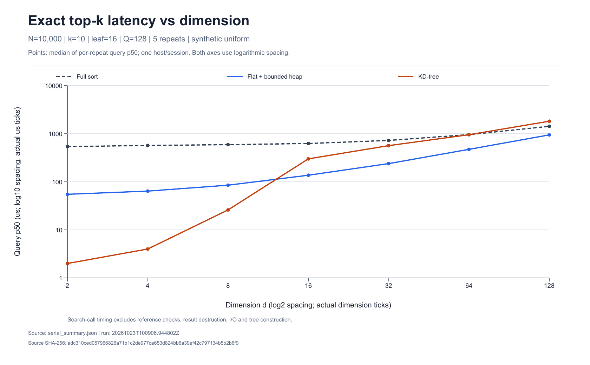

# ExactSearch

[](https://github.com/whx360/exactsearch-cpp/actions/workflows/ci.yml)

C++17 精确向量检索引擎：完整排序参考、手写有界最大堆、KD-tree 分支限界，以及持久线程池批查询。核心库只依赖 C++ 标准库；输入校验、确定性排序和实验复现与算法实现一起提供。

**核心问题：在结果完全一致的前提下，什么时候索引比扫描快，什么时候并行值得使用？** 实验同时保留加速和退化的情况。

## 构建并验证

需要 CMake ≥ 3.16、C++17 编译器；Python 3 用于额外的 CLI 与实验记录校验。

```sh
git clone https://github.com/whx360/exactsearch-cpp.git
cd exactsearch-cpp
cmake -S . -B build -DCMAKE_BUILD_TYPE=Release
cmake --build build --config Release --parallel 2
ctest --test-dir build -C Release --output-on-failure
./build/exactsearch demo
```

Visual Studio 多配置生成器的演示路径为 `build/Release/exactsearch.exe`。Windows 便携 GCC 也可使用 `scripts/build.ps1 -ToolchainRoot <w64devkit目录>`。构建产物、工具链和下载数据均不进入版本库。

`demo` 使用人工可核验的二维样例；无需下载数据。测试涵盖等距 id 排序、重复点、空集合、k 边界、随机差分、数值边界、损坏文件、异常传播、并发调用和中文绝对路径。

## 实现与契约

```text
fvecs ──严格解析──> 连续行主序 Matrix
                         ├── sort：完整排序参考
                         ├── flat：顺序扫描 + 有界最大堆
                         └── kdtree：中位数分区 + AABB 下界 + 最大堆
                                      ↑
                         BatchExecutor：只读共享、独立查询区间
                                      ↓
                         确定性 (distance², id) Top-k
```

- 输入为有限 `float`，先转 `double` 再相减，按维度顺序累加平方 L2；禁用 fast-math 和浮点乘加收缩。
- 结果按 `(distance², id)` 升序；等距时较小 id 优先。`k=0` 返回空，`k>N` 截为 N。
- KD-tree 仅在 `box_lower_bound > worst_distance²` 时剪枝，保留等距候选；高维最坏仍需扫描全部点。
- 线程池在锁外计算，使用 future 传播异常；任何失败返回前等待所有已提交任务，避免局部结果提前销毁。
- 数据及索引在查询期间必须保持不变。`shared_ptr<const T>` 管理生命周期，不阻止外部可变别名。

| 方法 | 查询时间 | 候选空间 |
|---|---|---|
| 完整排序 | O(Nd + N log N) | O(N) |
| 扫描 + 最大堆 | O(Nd + N log k + k log k) | O(k) |
| KD-tree | 取决于访问盒与点数；最坏全扫描 | O(k + 树高)，另计索引 |

表中 k 取 `min(k,N)`，k=0 单独处理；KD-tree 索引约占 O(N + Md)，M 为节点数。具体不变量、下界推导与生命周期见 [设计说明](docs/design.md)。

## 实测结果

2026-10-23，Ryzen 7 7435H / Windows / GCC 14.2，Release。每组 5 次重复取中位值；单查询和批处理使用不同计时范围。

| 相同条件下比较 | 结果 |
|---|---|
| N=10000,d=8,k=10，flat → KD-tree | 单查询 p50：85 → 26 μs；点扫描比 8.55% |
| N=10000,d=32,k=10，flat / KD-tree | 239 / 565 μs；KD-tree 扫描 100%，出现退化 |
| N=10000,d=128,Q=128，flat 1T → 8T | 批处理：124.942 → 18.632 ms，约 6.71× |
| 真实向量，Q=1，flat 1T / 8T | 0.068 / 0.092 ms；线程调度开销超过收益 |



提供 [425 行原始记录](benchmarks/2026-10-23)、输入与实现哈希、完整配置、分位数定义和计时边界。[实验说明](docs/benchmarks.md)保留负面结果及复现限制。以上为固定机器的历史测量，不代表跨机器性能承诺。

## 复现实验

```sh
python -m pip install -r requirements.txt
python scripts/fetch_data.py
python scripts/verify.py
python scripts/run_experiments.py --quick
# 完整测量；先串行生成受控数据，再执行批查询实验
python scripts/run_experiments.py
python scripts/run_parallel.py
```

Python 脚本自动寻找 `build/`、`build/Release/`、`build/Debug/` 中的程序；其他构建目录使用环境变量 `EXACTSEARCH_BUILD_DIR`。性能实验须指向 Release。新结果写入被忽略的 `results/`，不会修改版本库中的历史实验快照。`--quick` 单独输出 smoke 汇总，不覆盖正式汇总。

公开真实数据为 scikit-learn 1.5.2 附带的 1797×64 digits 子集，1400 条语料、397 条查询，源行互斥、固定 seed=42；标签不参与距离。它用于检索验证，不训练分类模型。

## 工程入口

| 路径 | 内容 |
|---|---|
| [include/exactsearch](include/exactsearch) / [src](src) | 核心库、CLI、阶段微基准与批查询程序 |
| [tests](tests) | 手算、边界、随机差分、I/O 与并发测试 |
| [scripts](scripts) | 数据身份验证、独立 NumPy 参考、实验运行与快照审计 |
| [docs/design.md](docs/design.md) | 算法、复杂度、并发与输入契约 |
| [docs/engineering-notes.md](docs/engineering-notes.md) | 真实缺陷、定位过程与回归措施 |
| [docs/benchmarks.md](docs/benchmarks.md) | 实验协议、原始结果与结论边界 |

范围：静态内存向量的精确近邻搜索。不实现在线更新、ANN、GPU 或网络服务。小型真实数据不能支撑百万规模或生产部署结论。工具链与持续集成状态以实际运行记录为准。

代码采用 [MIT](LICENSE)。经典算法与数据来源见 [参考与来源](docs/references.md)；实现、测试和文档使用了 AI 辅助，经典算法不作为原创贡献。
