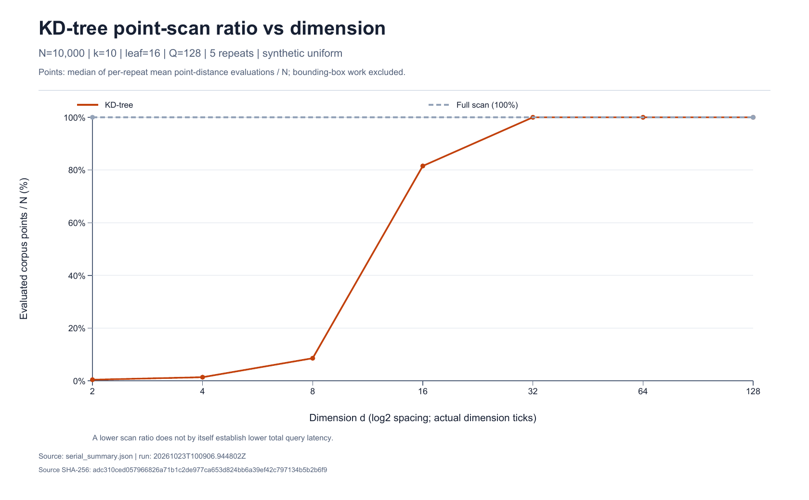
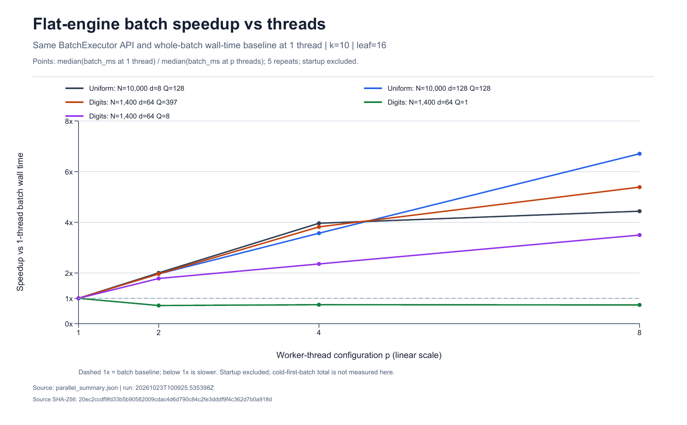

# 实验协议与结果

固定快照：[benchmarks/2026-10-23](../benchmarks/2026-10-23)。225 行串行、200 行并行，全部 `consistent=true`；每次计时查询均与完整排序参考比较。原始 CSV 与 summary 保留原始字节，`provenance.json` 是去除本机绝对路径的来源导出，记录输入哈希、运行身份、实现哈希、工具链与环境。打包时更新的脚本不是历史性能的重新测量。

## 环境与计时边界

Windows 11 x86-64，AMD Ryzen 7 7435H，16 逻辑处理器、约 15.74 GiB 内存。GCC 14.2 / w64devkit 2.0.0，`-O3 -DNDEBUG -static -pthread -ffp-contract=off`，未启用 fast-math，GPU 不参与。没有固定 CPU 频率、绑核或隔离桌面负载。

串行：15 配置 × 3 引擎 × 5 重复。三次查询预热，每轮轮换引擎次序。单查询计时仅包围 search 调用，排除读文件、建树、参考生成、验证、checksum 与返回结果析构。p50/p95 使用 nearest-rank；summary 是五次分位值的中位数，不能解释成所有查询混合后的分位数。qps 为查询调用时长总和的换算，不是服务端吞吐。

并行：5 负载 × 2 引擎 × 4 线程数 × 5 重复。完整 `BatchExecutor.search` 的墙钟计时，包含查询复制、结果分配、提交与 future 收集；排除构造、建树、校验与返回结果析构。1T 与多线程使用同一 API。startup_ms 只计构造，不等于完整冷首批查询。不能将串行 qps 与并行 qps 混算加速比。

## 输入与控制变量

NumPy PCG64 seed42，依次生成 N10000×128 语料和 Q128×128 查询，uniform(-1,1) double 采样后转 float32。维度干预统一取母矩阵前 d 列；N1000 取前缀，N50000 保留原 N10000 并用 seed43 扩展。改变 d、k、leaf 或 N 时固定该项其他条件。

真实输入：1797×64 digits 子集，以 Python random seed42 打乱源行 id，前1400行为语料，剩余397行为查询，源行互斥，标签不参与距离。40 个 query/engine 比较还通过独立 NumPy 数值参考；整数特征使本例的平方和能精确表示。这不代表对任意浮点输入做了全覆盖证明。

## 维度干预

N10000，Q128，k10，leaf16。单位为 μs，均为五次单查询 p50 的中位值。

| d | sort | flat | KD-tree | KD-tree 点扫描比 |
|---:|---:|---:|---:|---:|
| 2 | 540 | 55 | 2 | 0.40% |
| 4 | 570 | 64 | 4 | 1.35% |
| 8 | 592 | 85 | 26 | 8.55% |
| 16 | 626 | 137 | 300 | 81.53% |
| 32 | 725 | 239 | 565 | 100% |
| 64 | 957 | 473 | 953 | 100% |
| 128 | 1426 | 945 | 1819 | 100% |

KD-tree 在本次低维均匀数据上减少点距离计算；维度升高后下界变松，索引成本仍然存在。16 维不是普适阈值。真实 digits 上 flat/tree 为 65/87 μs，即使树只扫描 76.45% 的点也更慢。盒计算、分支与间接访问可能解释额外成本，但未做硬件计数器采样，不能认定某项已经被量化证实。

其他受控干预见完整 summary：d16 的 k=1/10/100/1000；d8 的 leaf=4/16/64；d16 的 N1000/10000/50000。叶更小可少算点，但盒和节点成本会上升；扫描比不直接决定耗时。

## 并行与反例

flat 引擎，单位 ms，数值为五次重复中位值。

| 负载 | 1T | 2T | 4T | 8T | 1T/8T |
|---|---:|---:|---:|---:|---:|
| uniform d8,Q128 | 11.362 | 5.670 | 2.867 | 2.560 | 4.44× |
| uniform d128,Q128 | 124.942 | 63.655 | 35.002 | 18.632 | 6.71× |
| digits,Q397 | 26.929 | 13.710 | 7.050 | 4.998 | 5.39× |
| digits,Q1 | 0.068 | 0.095 | 0.091 | 0.092 | 0.74× |
| digits,Q8 | 0.542 | 0.304 | 0.230 | 0.155 | 3.50× |

持久线程避免每批重复创建线程，但没有消除提交、唤醒和收集开销。独立批量查询受益，单查询反而更慢；不能把“使用线程池”等同于普遍加速。没有通过实验拟合统一的 Amdahl 串行比例，也没有测量跨机器最优线程数。

## Profiling 与限制

原始 `profile.csv` 为独立阶段微基准，包含距离写缓冲、完整排序选择、堆选择。每项预热后五次重复。阶段内存访问与完整查询不同，不能相加当成端到端耗时。操作计数包含点距离、盒距离、节点和堆更新；不是 CPU 采样或 cache miss 数据。

历史实验没有运行 ASan/TSan；索引容量估算不是进程独占内存。本快照不提供百万规模、在线更新、语义 Recall 或生产 QPS 结论。

复现：先 Release 构建，再按 README 运行 fetch_data、verify、run_experiments 和 run_parallel。新环境结果应保留自己的机器、编译选项与输入身份，不应强求与本机计时一致。离线完整性检查：`python scripts/audit_snapshot.py`。
